### Hey, I'm Nithika.

Undergrad at **IIT** who likes turning ideas into apps people actually use. Lately that means AI: study tools, support companions and agents that do real work.

- **Right now:** building AI-powered apps and joining hackathons with friends
- **Daily drivers:** TypeScript, Python, Next.js, Supabase
- **Ask me about:** LLM apps, Next.js, or how to survive a 24-hour hackathon

**Solo builds:**

| Project | What it does | Stack |
| :-- | :-- | :-- |
| [**Studimate**](https://github.com/senanayakenithikas-ux/studimate) | AI study planner, quizzes and tutor built on your own notes | Next.js · TypeScript · Supabase |
| [**Sana**](https://github.com/senanayakenithikas-ux/sana-emotional-support) | A calm AI companion for emotional support, on web and as an installable app | Python · JavaScript · Docker |

**Team builds**, made with friends:

| Project | What it does | Stack | Crew |
| :-- | :-- | :-- | :-- |
| [**Waypoint Sync**](https://github.com/Hirukadeven07/AiSleep_WaypointSync) | Delivery-day app for four roles, built for Rootcode's Tech-Triathlon 2026 | TypeScript · Next.js · NestJS | [@Hirukadeven07](https://github.com/Hirukadeven07) |
| [**Zenith**](https://github.com/ChamodiMadurasinghe/Zenith) | Agentic AI for cheque and invoice management in small businesses | Python · Flask · Gemini | [@ChamodiMadurasinghe](https://github.com/ChamodiMadurasinghe) |
| [**Agent Kernel**](https://github.com/sithilyapa717/agent-kernel) | Runtime for running and deploying AI agents at scale (contributor) | Python | [@sithilyapa717](https://github.com/sithilyapa717) |

Always happy to talk about AI apps, team up for a hackathon, or swap project ideas.

  
  

Stats update daily · Stay calm and ship

